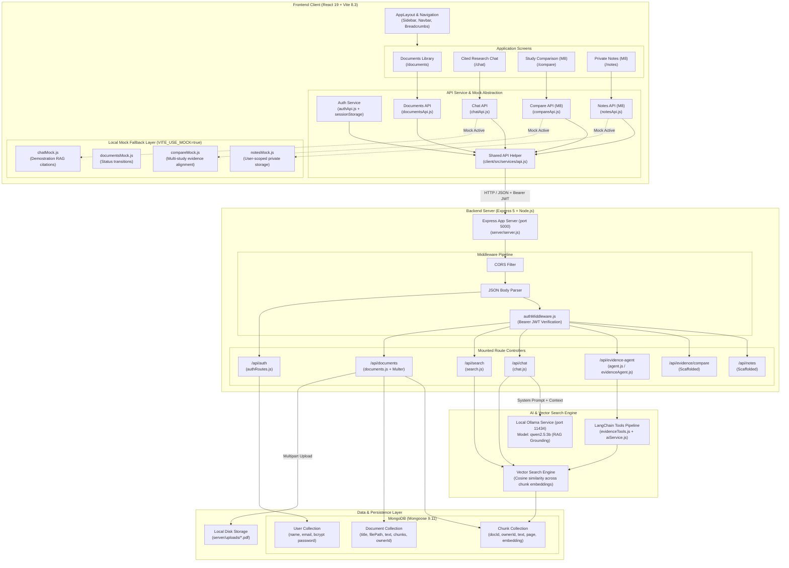

# Project 17 — System Architecture & Data Flow Diagram

This document presents the actual implemented architecture of the **Project 17: Research Reading and Evidence Workspace**, reflecting the active codebase across the client, server, database, and local AI layers.

---

## Architecture Diagram (Mermaid)

---

## Architectural Principles & Design Decisions

### 1. Unified Authentication & Authorization
- **Token Format:** JSON Web Tokens (JWT) signed with `process.env.JWT_SECRET` and expiring in 24 hours.
- **Client Storage:** Managed in `sessionStorage` (`project17_auth_token` and `project17_auth_user`). Session ends when browser tab closes.
- **Header Propagation:** Outgoing requests automatically include `Authorization: Bearer <token>`.
- **Query Scoping:** Every authenticated database operation scopes queries by `ownerId: req.user.id`, ensuring User A cannot read or modify User B's documents.

### 2. Mock / Real API Separation
- **Configuration Switch:** `VITE_USE_MOCK=true` in `client/.env`.
- **Service Layer Guard:** Every API service (`compareApi.js`, `notesApi.js`, `chatApi.js`) checks `USE_MOCK` first.
- **No Fake Success in Live Mode:** In live mode (`VITE_USE_MOCK=false`), real HTTP requests are dispatched to the backend. If an endpoint is offline or returns an error (such as 404), the UI presents an informative error with a Retry button rather than masking the error with dummy data.

### 3. Grounded Evidence & Anti-Hallucination
- **RAG Chat Grounding:** The chat endpoint queries the vector database for top K passages matching the query. If no passages exceed the relevance threshold, the system immediately returns `"There is not enough evidence in the selected document to answer this question."` without querying the LLM.
- **Explicit Page Citations:** Every retrieved chunk stores its source `page` number. Citations are passed to the frontend as structured `{ page: Number, text: String }` objects.
- **Missing Information Standard:** In Study Comparison, missing research questions, sample sizes, or limitations render as `"Not found in the paper"` rather than assumed or synthesized claims.
