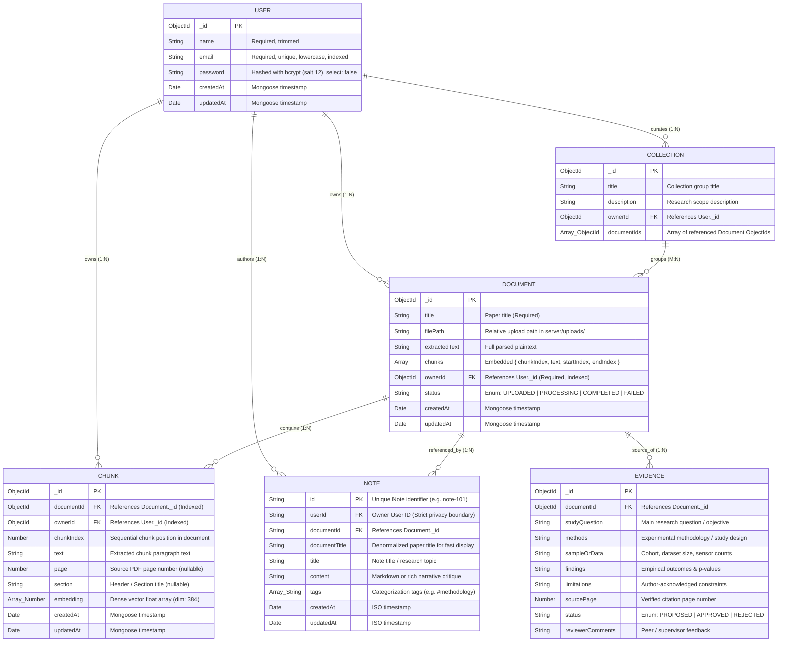

# Project 17 — Database Schema & Entity Relationship Diagram

This document illustrates the actual Mongoose database schemas implemented in `server/models/`, along with the scaffolded relations for Collections, Evidence, and Private Notes.

---

## Entity Relationship Diagram (Mermaid)

---

## Schema Implementation Details & Indexes

### 1. `User` Schema (`server/models/User.js`)
- **Indexes:** Unique index on `email` (case-insensitive normalized lowercase).
- **Security:** `password` has `{ select: false }`, ensuring password hashes are never returned in standard queries unless explicitly requested using `.select("+password")`.
- **Pending Schema Migration (M1 Blocker):** The current schema does not include a `role` field. Adding `role: { type: String, enum: ["student", "reviewer", "owner"], default: "student" }` is requested from Member 1 to support role-based authorization.

### 2. `Document` Schema (`server/models/Document.js`)
- **Indexes:** Indexed on `ownerId` for fast user-scoped library queries.
- **Embedded vs. Separate Chunks:** `Document.chunks` stores lightweight text slices and character offsets (`startIndex`, `endIndex`) for quick UI rendering, while vector embeddings are stored in the dedicated `Chunk` collection.
- **Status Lifecycle:** `UPLOADED` -> `PROCESSING` -> `COMPLETED` (or `FAILED` upon parser error).

### 3. `Chunk` Schema (`server/models/Chunk.js`)
- **Compound Unique Index:** `{ documentId: 1, chunkIndex: 1 }` prevents duplicate chunk creation when retrying a failed document processing operation.
- **Foreign Key References:** `documentId` and `ownerId` allow multi-tenant scoping and cascading operations.
- **Dense Vector Embeddings:** `embedding: [Number]` stores dense vector floats for cosine similarity search.
- **Source Page Tracking:** `page: { type: Number, default: null }` preserves exact page numbers extracted from the original PDF for citations in RAG answers and Study Comparison.
